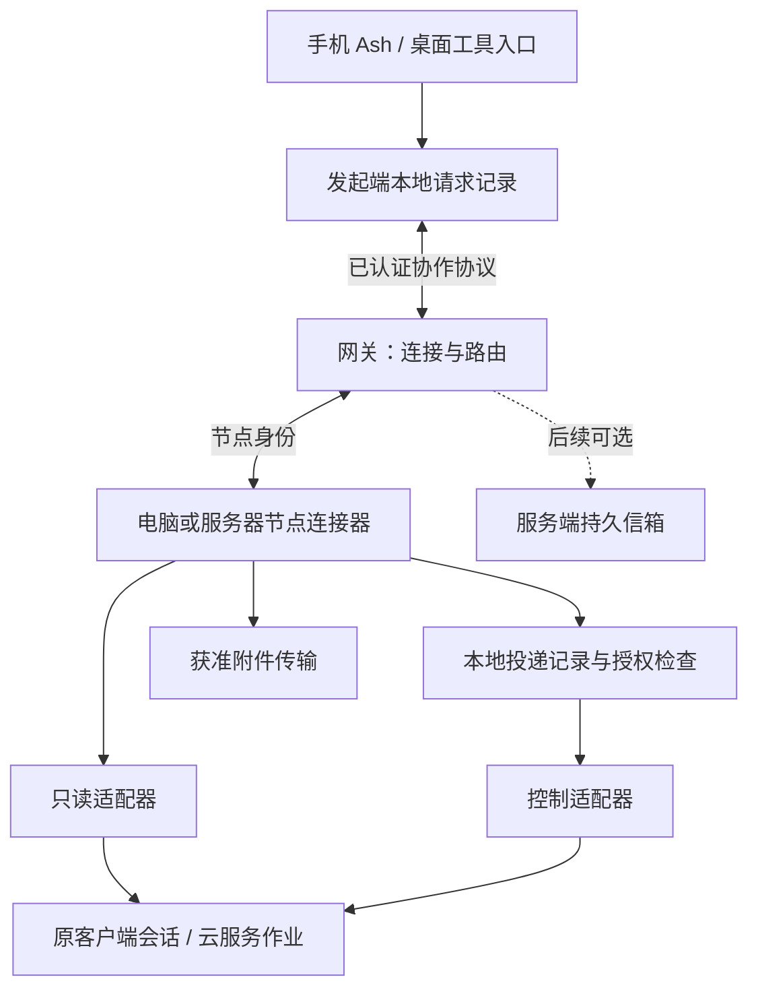

> 2026-10-13 实现更新：本分支已采用主分支kernel/edges/services与ash-link/1。跨端入口为原生电脑会话/浏览器human channel → service:collaboration → 电脑HandClient；图片复用签名side通道与Ledger/blob，结果走human stream。旧WorldRouter、OwnerLink和HTTP桥架构描述保留为历史设计，当前实现及验证边界见 [迁移记录](MAIN-ARCHITECTURE-MIGRATION-20261013.md)。坚持一切从简，主动索取材料与防重复专项延期。

# Ash 多端协作技术架构 v0.2

2026-10-09。研究与设计，未实现。对应[产品设计 v0.5](CROSS-END-PRODUCT-DESIGN-V2.md)。

## 1. 架构决策

采用“节点连接器 + 能力适配器 + 通用协作协议”。节点可以是手机、Windows / macOS 电脑、服务器；具体客户端会话或云作业仍由源系统管理。传输可集中部署，业务决策可由任意端发起，不要求手机常在线。

明确分开两条路径：查询历史、材料和结果的读取路径；创建、发送、追加、停止的控制路径。两者可以连接不同接口，不能以读取成功推断控制权限或实时状态。

默认按需同步：打开列表查询，进入工作读取最近内容，上滑分页，当前页面有界刷新；页面关闭后停止历史刷新。维持设备通信连接不等于持续同步所有聊天。首版不做逐字流式同步、全量历史复制或个人记忆自动合并。



图中新增模块是方案，不代表网关已有这些接口。源系统、节点记录、手机缓存各自承担不同责任。

## 2. 组件及部署

| 组件 | 职责 | 部署与边界 |
| --- | --- | --- |
| 手机交互层 | 目标选择、分享材料、展示缓存、输入、按需刷新 | Android Ash；不持有桌面执行凭据 |
| 协作协议层 | 标准请求、身份、工作引用、错误与结果关联 | 手机、电脑和服务器共用契约 |
| 节点连接器 | 配对连接、能力发现、范围授权、读写调度、幂等核对、附件 | 电脑扩展 ash-device；服务器可使用同类无界面进程 |
| 能力适配器 | 将通用操作映射到特定客户端或服务 | 按实例与版本注册；读取和控制分别声明 |
| 网关 | 已认证节点之间建立通道、投递有界消息、限制流量 | 复用现有网关基础；当前协议扩展须审计，非任意内网代理 |
| 本地协作存储 | 待发送请求、接收记录、源 ID 映射、缓存与同步位置 | SQLite，节点各自持有自己的记录 |
| 可选持久信箱 | 发起端退出后仍能中转已交付的请求 / 结果 | 后续服务端模块；不默认保存全部会话或运行业务 Agent |

优先采用现有 Node.js / TypeScript 设备端技术；手机沿用当前 Android 与 Core 结构。Windows 的进程管理、路径与凭据保护由平台层适配，不把 macOS 的绝对路径或启动命令当跨平台约定。服务器作业服务通过有限 API 适配，无需模拟桌面或聊天。

## 3. 现有代码复用与边界

| 当前实现 | 复用 | 需要新增或核实 |
| --- | --- | --- |
| packages/core/src/world/router.ts、ledger.ts | 消息校验、记录、client_id 去重、reply_to、已有授权机制 | 跨端通用操作的映射、期限及恢复；不另造重复的手机消息账本 |
| packages/core/src/server.ts 的本地 MCP | ash_describe / ash_send 的发现和发送模式 | 不能把外部节点标成 local owner 或转发本地 token |
| packages/device 的配对及网关传输 | 节点接入、撤销、连接生命周期 | 当前路径偏手机到设备，多端路由与源节点授权仍需扩展 |
| agents/host.ts | epoch、操作标识、会话世代与未知结果保护 | 内存操作表不是跨重启持久投递队列，需补节点投递记录 |
| agents/codex.ts 等 | Ash 自己管理的独立运行器能力 | 单列为 managed-runtime，不能冒充 existing-desktop 会话适配器 |
| 已有结果文件与 workspace.read | 有界结果预览和获准文件读取的实现素材 | 当前工作区权限较宽，不直接作为通用外部附件授权契约 |

Gateway 属于设备包引用的独立依赖，不在本仓库 packages/gateway 中。现有设备权限由手机侧实施的部分，必须在多发起端设计中补为目标节点可验证的授权，不能让服务器自称“手机已批准”便获得执行权限。

不预先重构现有 AgentHost。新的工作发现和按需读取可以独立增加；只有确认为同种语义的控制操作才复用原运行器路径。

## 4. 标识和能力模型

- node_id：配对的设备或服务器身份，不随网络地址变化。
- endpoint_id：某节点上的具体客户端安装 / 服务实例。
- WorkRef：node_id、endpoint_id、kind、native_id；kind 可以是 conversation、job、invocation。
- ScopeRef：执行端自己的项目或工作区引用；cwd 是可选源数据，不是跨端统一 ID。
- request_id：一项逻辑协作请求；operation_id：一次明确操作，网络重试沿用；attempt_id：一次实际调用尝试。
- source_message_id / turn_id：原生系统标识，必须限定于对应 WorkRef。
- connector_epoch：检测进程重启；能力还包括协议版本和适配器版本。

能力单独声明 list_scopes、list_work、read_work、create_work、send_input、steer、answer_question、cancel、get_result、transfer_asset。声明包含支持条件：是否仅空闲可用、是否有原生幂等、能否查询操作、读取完整性与分页方式。未知与不支持要区分。

UI 根据能力展示入口。没有 steer 时不能把 send_input 包装成中途追加；没有 cancel 时不显示有效的停止按钮。同品牌不同操作系统与不同版本分别验证。

## 5. 协议草案

所有调用使用版本化、类型化、有大小上限的信封；节点身份来自认证连接，不信任正文自称。以下为拟议接口：

```json
{
  "protocol": "ash.collaboration.v1",
  "request_id": "req-...",
  "operation_id": "op-...",
  "target": {"node_id": "node-...", "endpoint_id": "codex-desktop-..."},
  "action": "send_input",
  "work": {"kind": "conversation", "native_id": "thread-..."},
  "input": {"text": "将时长改为30秒", "assets": []},
  "precondition": {"expected_turn_id": "turn-..."},
  "expires_at": "2026-10-09T12:00:00Z"
}
```

授权引用由可信客户端附加并由目标核验；不把授权放进模型可自由构造的正文。operation_id 重用且正文摘要不同必须报冲突，不可覆盖旧请求。

响应包含 operation_id、delivery_status、native_refs、observed_at、结果或明确错误。delivery_status 建议为 recorded、accepted、rejected、unknown；它描述投递，不描述业务是否完成。accepted 必须说明是连接器接收还是原生系统接收，UI 只有后者才能显示“已送达 Codex”。

读取接口返回 items、native_revision（如有）、分页游标、observed_at、完整性和状态来源。原生分页游标是 opaque；不能假定支持永久增量或更新订阅。

统一错误类别：offline、permission_denied、unsupported、busy、stale_precondition、not_found、expired、conflict、result_unknown。保留经处理的源错误用于诊断，不把凭据、全量 prompt 或私有正文写进日志。

## 6. 三条核心时序

### 打开 Ash 查看桌面会话

手机展示缓存 → 向目标节点发起 list_work → 用户选会话 → read_work 最近页 → 按稳定 ID 合并新增和更新 → 按需加载旧页。

Codex 首选已实测 thread/list、thread/read、thread/turns/list。列表去重，最近轮次重读以更新在途消息。内部数据库与 JSONL 只作为必要的兼容后备，使用只读访问；不写原数据库，不依赖反推内存状态。

当前页面刷新间隔初始建议 3–5 秒，仍需实测。一次请求完成后再调度下一次，失败退避、离页取消；不允许刷新堆积。旧内容缺失不能马上判定源删除，先检查分页、权限与源错误。

### 手机向正在执行的会话追加

手机持久记录 operation_id → 节点校验授权与目标 → 节点保存 received → 调用拥有该活跃会话的控制接口 → 保存原生接收回执 → 返回手机 → 后续历史读取确认消息与回复。

先写调用意图，再执行外部调用；但本地记录与原生调用无法原子提交。若调用之后、保存回执之前崩溃，标记 unknown 并核对，不自动重做。拥有原生幂等键才可按其契约重试。

默认追加不终止正在执行的工具。用户明确“下一轮再做”时要求真实排队能力，否则告知限制。只在可靠控制源提供活跃 turn_id 时使用 expected_turn_id；独立历史接口的 interrupted / notLoaded 不能作为忙闲证据。

### 跨端局部交接

发起端生成限定背景与材料 → 保存来源 WorkRef 和返回地址 → 目标执行端创建会话或作业 → 回传新 WorkRef → 发起端以后查询结果 → 按权限回到来源或显示可领取。

手机可以全程离线。若通信服务不支持节点间路由，先明确该能力尚未实现，不经手机伪装为去中心发起。业务依赖、视频模板和发布规则由发起者及源项目负责。

## 7. 存储、幂等与离线

候选逻辑表，不要求 Core 再建相同功能的物理表：

| 数据 | 主键 / 约束 | 用途 |
| --- | --- | --- |
| endpoints | node_id + endpoint_id | 授权、能力版本、最近可达性 |
| work_refs | node_id + endpoint_id + kind + native_id | 源对象与范围映射 |
| operations | principal + operation_id 唯一；payload_hash | 目标节点接收、调用与回执恢复 |
| operation_attempts | operation_id + attempt_id | 外部调用事实、时间与核查结果 |
| message_mappings | operation_id ↔ 原生消息 / 轮次 ID | 手机乐观消息与源历史合并 |
| sync_cache | WorkRef + 原生 item_id | 内容快照、版本 / 摘要、观测时间 |
| assets | asset_id + 内容摘要 | 获准范围、保存位置与有效期 |

状态转换与去重记录本地事务提交。仅 operation_id 去重不能保证原生系统恰好执行一次；缓存内操作表也不能跨重启提供该保证。

第一阶段持久待发送保存在发起节点，已接收记录保存在目标节点。手机被系统挂起时，未交付请求不会神奇地继续投递；产品须写明“打开 Ash 后重试”或维持已验证的后台机制。不能承诺手机关机、目标晚些上线仍自动开始。

若后续必须支持两端不同时在线，再加入服务器持久信箱：写入成功后才报“已保存，等待目标”。领取可使用租约与 ACK，但 ACK 只证明投递接收，不证明业务完成；目标仍必须幂等和核对。通信数据库与原业务数据库保持分离，网关不托管所有聊天副本。

对本地缓存、请求元数据和附件分别设置保留策略及存储上限。最小实现先明确可配置项和清理行为，不在未获用户选择前承诺永久保存。删除缓存不删除源会话；删除协作记录不等于取消源任务。

## 8. 附件与权限

附件引用包含 asset_id、类型、大小、内容摘要、来源和版本。取文件时验证当前授权、请求范围和有效期；断点传输完成后核对大小与摘要，确认到达前不显示已交付。链接只用于获准接收方，不成为永久公网下载地址。

优先复用既有传输；大文件后续可分块或对象存储，不能把视频字节塞进普通消息信封。Windows 与 macOS 的路径保持本地语义。源文件变化产生新版本，旧确认不能自动套用。

节点接入使用配对身份，目标节点再次核验动作范围，支持撤销。读取指定会话、写入该会话、访问文件是不同权限。传输需认证和加密；现有网关的端到端保密属性未在本稿审计，不宣称中继看不到内容。部署若要求不信任中继，应额外设计并验证端到端加密。

现有 managed-runtime 的全 OS 账号权限必须明确显示。无法限制动作时不能因协议字段写了“只读”便宣传隔离。敏感令牌保存在各端凭据存储，跨端仅传授权引用；模型摘要不能授予权限。

## 9. Codex 适配器的具体决策

ReadAdapter：独立本地 App Server 的已保存历史读取，本机实测成功。按需启动或复用有界连接，严格只调用读取方法，避免为查看历史调用 resume/start。

ControlAdapter：连接管理目标桌面会话的共享 App Server daemon。已在同一 Unix daemon 上完成用户 GUI 发起、外部 turn/steer(expectedTurnId) 同轮追加的指定场景验证；独立历史读取进程不能承担该控制。原生 transport 核查 Unix listener、可执行文件和支持版本，连接 epoch 变化使旧活动状态失效。生产连接助手仍需配置发现和生命周期接线；普通用户点击桌面图标并不等于已加入共享 daemon。控制不可用时明确显示原因，不通过写 SQLite 或另起运行器替代。

ManagedRuntimeAdapter：保留原 Ash 自己启动的 Codex / Claude / WorkBuddy 运行器，使用不同 endpoint_id 与明确标签。用户选择已有桌面会话时不能自动降级到该适配器。

指定项目创建沿用用户确认的 itsallsame 路径；在集成时核对契约即可，不重新争论该能力是否存在。已有模拟与指定 GUI 对照证明追加在同轮最终回复生效、原等待命令正常结束；不推广为任意工具即时响应。晚加入可从当前原生 active 状态及唯一历史 turn ID 候选定位，标记 identity_provenance，并由 expectedTurnId 校验目标；历史不承担实时工具状态证明。未知投递仅查询或显式有界核查，不自动重发。

## 10. 实施拆分与验证门槛

本节是后续工作顺序，不是开发授权。

1. 研究外部 Codex 控制入口，明确能否发送、追加及取得稳定回执；这决定原桌面会话控制能否交付。
2. 设计协议类型与适配器契约，映射已有 Core 路由及设备传输，先避免重复账本。
3. 实现时先做 read adapter 与手机按需列表 / 详情，再集成经验证的 control adapter 和节点投递记录。
4. 增加限定附件及手机问题回复，完成分享启动、跨轮次读取、追加与结果领取闭环。
5. 加第二个操作系统或客户端适配器，再加一个无聊天语义的云作业适配器，检验通用性。
6. 用户需求确实要求跨离线自动投递时，才扩展服务器持久信箱。

验证重点：发送前断线、调用后回执丢失、节点重启、重复请求、目标会话忙碌或删除、撤权、同名项目、附件版本变化、分页中历史更新。每项验证都需检查错误行为，不只检查正常回复。

观测日志只记录 request / operation / attempt ID、阶段、耗时、错误类别与接口版本；默认不记录正文。关键指标是错误投递数、未知结果数、重复执行数、缓存新鲜度和消息回收成功率。异常控制入口不得通过自动扩大权限解决。

架构成立的门槛：跨工具扩展无需新增内容生产业务状态；读取与控制的能力限制能被产品准确表达；任一断线都不会把“未确认”展示为“已完成”。


## 11. 安装、配对与分发架构

默认托管部署由服务方运行网关，用户仅安装 Android Ash 与对应系统的电脑连接助手。连接助手由桌面设置壳、节点后台进程、随包运行时及客户端适配器组成；复用现有 ash-device 后台逻辑，不要求用户自行安装 Node.js。打包技术、签名与各系统安装形式待实现阶段确定。

电脑助手负责检测已安装客户端及其版本，不携带用户的第三方登录凭据到手机。能力探测优先初始化和只读请求，不以自动执行付费模型任务作为健康检查。支持情况依“客户端版本 × 操作系统 × 接口能力”记录，不仅依程序是否存在判断。

优先复用一次性配对码流程。新设备获得独立身份及限定授权，目标节点验证每次请求；原始节点凭据使用系统凭据保护能力，后台配置仅保存必要引用。是否支持统一产品账号后续决定，首版不强制另建账号系统。

后台默认通过客户端主动出站连接网关以适应常见 NAT 网络，不要求普通用户开公网端口。安装时确认系统登录后启动设置；macOS 和 Windows 使用各自受支持的启动机制。助手退出、系统休眠与进程崩溃按不同原因暴露状态，恢复后重新认证、重新发现能力并核对未确认操作。

首次安装检查分层报告：软件安装、配对认证、网关连通、客户端可读、客户端可控、默认范围有效。只有支持且验证通过的能力显示就绪；读接口通过不解锁发送按钮。

## 12. 托管、自托管和运行维护

### 托管最小部署

初期复用现有网关及 TLS 入口，提供设备连接与路由、撤销校验和服务健康监测。服务端持久信箱是可选扩展，与按需读取聊天分开；不为了开箱即用而默认构建全量云端历史库。

节点与网关握手时协商协议版本与能力。不兼容时保留本地缓存、停止不兼容动作、提供更新指引；不能降级到更宽权限或不具备去重保障的通道。服务端部署先兼容存量客户端，再逐步启用新能力。

### 自托管交付

目标是提供可校验版本的部署包、配置模板、健康检查和升级说明。具体采用单机服务还是容器包应在网关依赖审计后确定，不在本稿声称已有一键部署。

管理员承担域名 / TLS、必要密钥、持久卷、服务重启、备份恢复及监控。终端通过配置链接或二维码获得网关地址与配对入口；链接不得携带长期管理员密钥。迁移到另一网关需要明确重新绑定或受控迁移，不自动信任新服务。

### 升级与诊断

发行物按操作系统和架构提供，校验来源与完整性。桌面签名、公证、Windows 安装签名及 Android 签名更新连续性属于发布验收项，当前未宣称已完成。稳定渠道与测试渠道分开，界面展示版本及兼容范围。

升级前核对是否有活跃控制调用。可延迟更新；必须重启时不重放结果未知的动作。存储迁移需事务或可恢复备份，回退仅在数据格式兼容时允许，不能承诺任意版本直接降级。独立验证升级中断、配置保留、身份保留及重复启动。

诊断信息默认包含版本、连接阶段、时间、错误类别与关联 ID，不包含 Token、聊天正文或完整本地敏感路径。用户主动导出诊断包时可预览范围。监控网关可用性不等于监控或读取用户所有会话。

卸载或退出助手不等于停止原客户端任务；撤销配对阻止后续访问，不能撤回已传出的副本。产品需分别提供退出、撤销连接、本地缓存清理与卸载说明，不混成一个含糊的停止按钮。

## 13. 从零运行的验收清单

- 干净系统安装对应签名包，依赖随包齐备；不要求终端、Node.js 或手工写配置。
- 一次性配对成功、过期可恢复，设备名称和授权范围清楚；撤销后新请求被拒绝。
- 客户端未安装、登录未知、只读可用、控制不可用分别显示，不误报全功能就绪。
- 用户选择真实项目后主动发起请求，两端关联一致；默认项目变更不修改旧请求目标。
- 手机离页停止历史刷新；电脑休眠和助手退出时展示缓存及时间，恢复不重复执行。
- 升级失败与网络失败可恢复，未知回执保留核查状态；不要求用户重新登录所有第三方工具。
- 自托管从配置、启动、配对到备份恢复有独立说明，不能把服务端配置步骤塞给默认托管用户。

此清单是后续实施验收标准。本轮只完善文档，没有打包、部署或改变任何设备配置。

## 2026-10-11：客户端文字恢复的最小实现

桌面协作输入以有界 localStorage 快照保存，按入口 endpoint、认证 scope、原授权 revision 与会话/项目绑定，草稿记录闲置 24 小时后过期。输入事件直接保存，不替换输入元素。分享接收返回成功之前同步写入并读回；待处理分享转入目标草稿采用同一快照更新，重复分享 ID 有界去重。scope 未建立时不读取或清空其他身份正文。

发送前先核对既有操作记录落盘，再清未发送草稿；未知投递只查原 operation。控制 outbox 已保留原输入，新建 outbox 对新记录增加有界提交正文，失败/未知在既有详情只读展示，三个创建阶段确认接收后清正文，兼容旧无正文记录。这是本地恢复用途，不记录到诊断日志，也不建立新的服务端任务或消息账本。

## 2026-10-11：单图会话输入

新增窄图片 composer 协调器复用原材料 port/store 与 saveDraft/submitInput/transfer/sendInput；原控制输入框保持同节点，只增加图片选择和文件名移除。单选 max_files=1 扩展既有 material_select 严格 schema，旧4文件模式保持。HomeActivity 单选 PNG/JPEG，数量/URI/MIME/报告大小在开流前检查，实际字节上限与 hash 继续由可信导入核验；主动取消和固定失败码区分，不暴露 URI。选图期间隐藏不取消原操作，返回核原身份/WorkRef/revision，发送点再核可见性。未知恢复沿已有 operation ID 查询，文件未完整传输不发送、不降级文字；选择错误保持图片意图到明确移除。receive_input 仍要求精确会话授权，普通文字项目控制不扩为文件接收。


### 读取授权在正常重启后的恢复（2026-10-11）

持久读取授权绑定配对 owner/endpoint、source_id、确认的 Codex/SQLite 根目录和 profile、账号 account_id 与 subject 的摘要以及 allowedCwds。账号摘要只用于本地连续性判断，不导出令牌。配置文件全文、令牌内容、inode、mtime/ctime、可执行文件构建不进入持久绑定；可执行文件兼容性和来源仍分别验证。

每次读取仍保留当前文件描述符、配置/程序/账号文件连续性与进程 drain 检查。文件改写使旧证明失效，重新捕获同一账号和来源后可使用原授权；账号、根目录、profile 或范围改变仍拒绝自动继承。刷新会重新核对来源，不永久缓存读取失败。当前只支持可验证的本地 ChatGPT 账号身份；未知身份和 API-key 模式不自动推断。

旧 v3 缺少新的稳定账号基线，不做静默迁移。本次在用户此前允许的 ash 项目范围内通过正常 setup.prepare/apply 写入新基线，未扩大读取范围。
