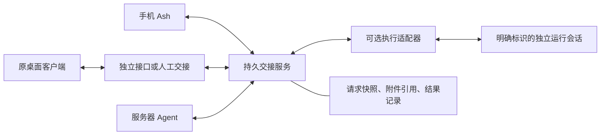

# Ash 跨端协作：业务、产品、技术五轮对垒

> 后续：结合手机分享内容新建 Codex 会话、选择已有会话续接，以及外部会话列表实测，形成 [产品设计 v0.5](CROSS-END-PRODUCT-DESIGN-V2.md)。本报告保留对垒时点的结论；其中尚未验证项的最新状态以主稿的最新证据表为准。

2026-10-09。第二次对垒，纠正前次以预算为主的讨论。本次只研究和设计，未开发产品代码、运行真实 Agent 任务或修改设备配置。

## 参与与边界

四位独立 Agent：A pro_context支持场景与产品，B pro_network支持技术架构，C con_value反对场景与产品，D con_execution反对技术架构。每轮四人完成后共享摘要，下一轮回应对方；受并发限制分批完成，同轮输入相同。五轮共20次发言，下文为归纳而非逐字记录。

评审对象：同一用户跨手机、电脑和服务器的上下文启动与协作；任意端发起，拆分可选，局部信息即可，人工路径允许，不要求完整会话迁移。Ash是参与者和连接能力提供者，不是必须经过的唯一AI调度中心。

## R1：场景是否真正需要互联

- A支持：手机补充演示或周报要求，关联已确认目标、决定和材料；少做重述前情、找附件、回忆旧方案。桌面向有数据的设备请求汇总，结果能归回原问题。
- B支持：跨端独特价值来自资源位置和多次往返关联；服务器处理大文件不必先拆任务树。若SSH或复制已足够，不能强行引入网络流程。
- C反对：稍后继续、现在请对方处理、仅保存分享是不同意图；手机记录要求不等于授权电脑上线自动执行。自动拼成长摘要可能选错旧方案。
- D反对：收到请求不等于输入齐备，也不等于可以覆盖正式报表；先明确输入版本和输出。分享解释通常笔记够用，任务状态可能添负担。

裁决：保留三种意图，避免统一成模糊的发送按钮。纯分享不建执行任务；业务差异不要求三套传输系统。任意端发起不等于每个客户端天然支持工具调用。

## R2：用户究竟怎样操作

实例一：手机说“按昨天口径更新周报”，电脑离线。

- A/B支持短卡：项目、候选明确口径、输入文件、生成新副本；选择上线后处理或稍后自己继续。存在两种口径时只问冲突点，不让用户读长摘要。
- C反对默认执行：先草稿，用户选定意图前不派工。默认只选本项目已确认决定，不注入全局历史。
- D反对虚假确认：已复制只是准备完毕，用户勾选已粘贴只是用户报告，不能冒充目标端接收。文件缺失或版本变化时返回具体缺项。

实例二：原Codex客户端要求WorkBuddy整理，但目标只支持人工交接。

共同可接受路径：原端有接口时原地生成短交接卡；无接口时必须有显式导出/复制步骤，不能假装系统听到了客户端内的请求。交接内容含资料、要求、产出形式与返回标识；结果人工带回或经已支持通道回传。B承认仍需搬资料和带回结果，收益仅在少拼装背景、少恢复关联。

裁决：卡片是默认轻量交互；目标、差异、材料和下一步可见。只在实际歧义、冲突、缺项或授权范围变化时增加确认，已有明确授权不机械重复。可靠离线排队在此阶段只是产品提案，下一轮检查实现。

## R3：代码现实与最小架构

B/D独立只读检查，主持复核了相关实现：

| 代码事实 | 不能由此推出 |
|---|---|
| codex.ts:34启动独立app-server；:55恢复自己的seed | 已接入用户原桌面会话 |
| claude.ts使用独立stream-json进程，workbuddy.ts启动CLI/ACP | 可以操作这些产品任意已有UI会话 |
| mcp.ts:16要求活跃turn | 已有独立、通用的桌面客户端入口 |
| host.ts:35无持久动作队列，:89等做同进程去重与epoch检查 | 已实现跨重启离线派工或恰好一次执行 |
| host.ts持久保存seed和最终结果 | 结果一定能自动回写发起客户端 |
| codex.ts:57全访问，其他运行器存在bypassPermissions配置 | 提示词中的只读要求是可执行的权限隔离 |

A据此撤回“当前能可靠排队上线执行”的暗示；当前无对应实现时只能显示草稿或待提交。C强调结果回收件箱与回原会话是两种能力。

B主张独立收发入口、持久收件服务和可选执行适配器；D认为前两项值得做，但不能因此宣布执行可靠。C倾向先完成交接，执行按能力开放。独立MCP是候选接入方式，不会自动赋予所有客户端接入能力。

裁决：任意端发起和集中部署通信服务不冲突。可以用用户服务器存待取请求和结果，服务只承担通信与记录，不必成为唯一AI决策者。若服务不可达，本地仅待发送；发送者离线时，已送达服务的结果可在保存期内领取。附件必须可被授权读取，本机路径不是跨设备附件。

## R4：反例迫使设计放弃什么

| 故障 | 攻击与最小修正 | 必须放弃的承诺 |
|---|---|---|
| 写完文件、回执前崩溃 | D指出收件ID不证明执行；B/A接受请求与尝试记录、产物清单及核查，C要求界面先检查输出 | 重发就能安全恢复、保证恰好一次 |
| 两端确认互斥口径 | 保留来源、适用范围和基于版本；只暂停依赖冲突的请求，结果标明采用版本 | 设备时间较新就一定正确、离线全局无冲突 |
| 发起端离线或原会话删除 | 独立请求记录保存结果，提前告知领取位置与期限；可导出到新会话 | 自动恢复原会话私有上下文 |
| 排队后撤权、附件已导出 | 取附件与开工前检查现行权限，区分关闭后续访问、请求停止和副本已外传 | 一键撤回全部副作用与副本 |
| 工作材料夹带新指令 | 同一用户仍需按目标授权；引用材料不扩大权限；宽权限执行需诚实说明或实际隔离 | 靠摘要或提示词保证资料用途 |
| 执行者循环转派 | C提出首阶不默认递归转派；主持采纳，后续显式开放需委托链与限额 | 先有无限自治再补控制 |

C另外攻击“收件箱天然闭环”：如果用户必须多记一个要巡查的地方，产品仍可能更麻烦。裁决是发出时明确结果位置，原入口能查询则原地查询，做不到就明确人工领取；不能用后台保存替代用户可发现性。

持久记录、临时目录或完成清单只是实现提案。任意外部动作可能已经发生且无法回滚，未知必须保留；删除聊天不能推断为取消任务。

## R5：最终方案

- A支持：保留可追溯决定、请求回复关联、自动与人工共存；希望至少一条经核实连接验证自动提交和回收。结果可建议更新背景，不能自动成为用户决定。
- B支持：独立入口、持久服务、一个受限执行适配器。优先用手机周报闭环检验自动回流；否则只测资料打包，无法判断自动协作增益。
- C反对：先自动准备有来源的背景，按连接逐项开放执行，不以自动派工为默认。接受一个通过隔离验证的连接，要求原客户端入口真能使用，收件箱尽量留在后台。
- D反对：先保证交付，不先建立通用执行队列再补故障语义。允许限定连接通过验收后自动处理，仍反对通用无人值守写操作。

仍存差异是验证顺序和自动化的初始承诺，而非绝对反对自动化。支持方希望首阶就测一条自动闭环；反对方要求先把上下文交接及执行门槛落地。不能将最终趋同夸成彻底消除分歧。

主持裁决：保留一条限定自动连接作为验证目标；可投入使用的自动执行必须经过接口、权限和恢复验收，其余连接允许人工交接或仅传内容。收件服务可先持久保存任务意图，但不得把尚未通过验收的意图自动派给宽权限运行器。

保留：局部上下文启动、任意端显式发起、原客户端习惯、请求与结果关联、明确的人机交接。延后：自动全局记忆合并、普遍会话接管、默认递归转派、强制任务树、大量连接器和未知状态自动重做。

本轮没有全面胜出的阵营：支持方证明有具体跨端机制值得设计，反对方纠正入口、状态与权限的过度承诺。没有实际用户或故障测试，所以不能据此宣布产品或技术已经验证成功。

## 候选最小架构（设计提案）

手机Ash、桌面原客户端、服务器Agent各通过自身可用入口访问交接服务。入口可能是独立工具接口、分享/导出或人工复制。交接服务保存请求和结果，不承担所有AI决策；执行适配器按连接能力加入。

图中双向箭头表示目标设计，并不宣称所有客户端已有接入。发起入口去中心化，不要求存储和传输必须P2P。

协议核心只约定请求ID、认证身份与目标、意图、正文、创建时间、回复关联、背景快照、附件引用、适用访问范围。身份来自认证上下文，不能信任正文自称。执行请求再附输入版本、输出范围、本次授权依据和尝试标识；不要求纯分享携带任务树或执行状态。

状态区分本地草稿、服务已持久接收、目标接收、执行者报告完成、产物核验与结果未知。手动标记必须表明来源，不能伪造运行器回执。真正的执行隔离由运行环境或受限工具落实，正文约束只是意图。

共享上下文先包括用户明确选择的个人背景和项目目标、决定与替代关系、参考资料和上次交接结果；不是取消个人上下文，而是延后全局自动采集和自动注入。每次交接固定一份快照，后续更正另作事件；接收方可以请求补充，而不是假装初始摘要完整。

## 必须验证而非假定的接口

1. 至少一个原桌面客户端能否由用户在原会话主动调用独立提交、查询和取结果入口？MCP是候选方式，当前私有turn绑定实现不满足独立入口要求。
2. 同一原客户端能否读取选定资料和人工回传结果？没有能力时具体需要几次手动动作？不以托管新会话冒充接入成功。
3. 请求已接收后重启、文件生成后回执前中断，是否能恢复为可证实结果或明确未知，且不盲目重做？
4. 限定连接是否真的限制文件写入和资料外发？全访问进程即便能正常输出，也不能算隔离验证成功。
5. 发起端离线或原会话不存在时，结果能否在约定期限内被有权限的用户找到和领取？

这些验证尚未执行。通用原客户端接入、持久离线交接和权限隔离都不能标作已经完成。

## 首个完整场景的建议验收

使用合成周报资料和非敏感的明确口径。手机选择请求、目标及输入输出范围；经持久接收后由限定电脑执行者生成副本。手机离线，电脑在产物生成后、回执前中断；恢复后重复查询和重复提交同一请求。

要观察：越界写入是否被真正阻止；重复提交是否不会自动开始新尝试；文件与完成记录不一致时是否保持待核实；结果是否关联原请求并可在手机重新上线后领取。没有完成清单不能仅凭文件存在宣称任务成功。该场景只能证明限定连接，不能外推任意App外部副作用都能恢复。

另外必须做原桌面客户端发起的交接验证，以免第一条手机流程成功后仍停留在Ash单一入口。原客户端是否支持独立接口应先只读核查；不支持时明确记录人工步骤，不能拿后台托管新会话代替这项验收。

这些是后续研究和验证计划，当前未启动开发或真实执行。

## 附带预算与用户确认

预算只在第五轮作为附带机制：B和D提议当前25/更简20/验证35/保留20，C提议25/20/30/25；A最终集中提交了设计裁决，未重报金额。主持参考采用25/20/35/20，合计100，代表未来公司资源的条件性暂案，不是当前token消耗或拨款授权。预算结果不替代本报告的业务、产品和技术判断。

四位辩手均未提出阻止研究继续的必需用户决定，因此未额外暂停确认。部署地点、数据保存期、真实支出和执行范围等，在进入实际方案实施前还需明确；本轮没有替用户批准这些选择。

## 代码证据

- [Codex托管会话与权限设置](/Users/ahaha/work/xiebo/ash/packages/device/src/agents/codex.ts:34)
- [私有MCP的活跃轮次约束](/Users/ahaha/work/xiebo/ash/packages/device/src/agents/mcp.ts:16)
- [设备会话与非持久操作队列](/Users/ahaha/work/xiebo/ash/packages/device/src/agents/host.ts:35)
- [Claude进程适配](/Users/ahaha/work/xiebo/ash/packages/device/src/agents/claude.ts:23)
- [WorkBuddy独立CLI适配](/Users/ahaha/work/xiebo/ash/packages/device/src/agents/workbuddy.ts:35)
- [设备端权限与恢复说明](/Users/ahaha/work/xiebo/ash/packages/device/README.md:35)

证据限于当前代码的静态读取，未验证模型提供商执行结果。本轮没有将未经核实的第三方最新功能当作可用事实。讨论由同一模型家族的独立角色产生，主持也参与过原设计，不能替代真实用户研究或独立实现审计。
