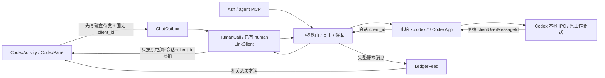

# Codex 应用产品验收

手机接续电脑已有工作是这次验收的单位：认得电脑和会话，能发送、批准电脑请求并读到结果；切到另一台电脑再回来，原来的工作、草稿和阅读位置还在。应用独立启动，全程不建立或占用主聊天页面。

## 数据流与生命周期



`onStart` 注册完整账本监听并读当前路由；共用连接的 follow 完成初始页后才通知连通。重连从最后收到的 seq 补页，最后一页后重新读取页面。最后一个 Activity `onStop` 注销监听并关闭 follow；迟到的 open 会立即关闭，旧订阅回调不再交给页面。Codex 自身离页停止轮询、失效旧读、隐藏键盘；发送回执仍更新它原来的磁盘操作，不把新路由带回旧电脑。回到前台重新读取，电脑会话仍是事实来源。读取产生的账本请求不再次触发同一读取。

## 真实通道路径

`packages/core/test/scenarios/codex-app.test.ts` 启动实际中枢、路由、关卡、账本，实际主人 WebSocket、agent MCP、两条设备 WebSocket，以及两个生产 CodexApp 的本地 IPC 连接。只脚本化模型和电脑 owner window，不使用主人的手机或 Codex 账号。

- 已有工作「修复结算页重复扣款」：主人和 Ash 各发同一句话，实际调用身份分别为 `person:owner` 与 `agent:main`，账本保留两者。电脑同一轮回显两条不同的真实 client_id。
- 电脑请求「运行退款回归测试」，主人调用 `x.codex.approve`，实际 IPC 收到对应审批决定。电脑随后完成，应用接口读到「退款幂等回归通过，重复扣款已修复。」。
- 第二台独立认证电脑打开「整理跑步计划」；回第一台仍读到原工作与结果。
- 电脑已收到操作但主人连接在回执前断开；重新认证后以同 client_id 明确重试一次。电脑 IPC 只收到一次原操作，重试返回 `repeated:true`。

执行：

```sh
TMPDIR=/data/atoll/tmp node --expose-internals --import tsx --test packages/core/test/scenarios/codex-app.test.ts
```

实际日志 `/data/atoll/tmp/ash-codex-product-paths.log` 已通过；可选环境变量 `ASH_CODEX_ACCEPTANCE_CAPTURE` 保存本次合成数据的真实通道结果，供查看来源与编号。

## 已复现的问题及修复

| 用户路径 | 修复前的证据 | 修复 |
|---|---|---|
| 向进行中的工作补一句话 | `steer` 回执没有 turn，旧 Pane 直接删除待发项；电脑原来又丢掉 clientUserMessageId，无法精确对账 | 回执只标记已发；等相同电脑、会话、client_id 的 user item 才核销。没有编号就继续保留，不按文字猜 |
| 我与 Ash 发同样文字 | 用真实 Codex IPC 测旧设备实现，输出 `[undefined,undefined,undefined]`，无法区别两条有编号的消息与一条无编号消息 | 独立设备窄补保留上游真实 user / steering user 编号；不为无编号记录编造身份 |
| 刷新或断线时还在输入中文 | 实际 Activity 测试发现离线后列表高度由 1678 变1664 | 状态栏固定占一行；替换文字保留 AshUi 原行高 span。焦点、composing、选区断言均保留，修后尚待串行复验 |
| 切电脑时旧操作回执回来 | 原发送成功可能把当前路由重新打开成旧会话 | 回执更新原操作；仅原导航仍有效时自动打开新会话。每台电脑和会话草稿独立 |
| 旧电脑下线 | 原读取失败把当前 device 清空 | 保留原工作、电脑名称和草稿，提示离线；主动退回列表才重新选择在线电脑 |
| 换会话后回来读原位置 | 原来仅重建 Activity 有单个锚点 | 切路由前记当前首行键和偏移，按电脑+会话恢复；仍遵守在底部时跟随最新 |
| 重连时有事件发生 | 原 follow 每次只拿最新一条，且在订阅前已通知连通 | follow 到位后才读；重连按已收 seq 补齐，再确认连通 |

旧设备失败日志 `/data/atoll/tmp/ash-codex-device-before.log`；修后定向真实 IPC 日志 `/data/atoll/tmp/ash-codex-device-targeted.log`；设备完整 20 项测试也在 `/data/atoll/tmp/ash-codex-device-after.log` 正常退出通过。以上离线布局失败出自真实 View 测试 `/data/atoll/tmp/ash-codex-activity-tests.log`，不是 Model 推断。测试窗口必须显式进入有焦点状态，不能删除输入焦点断言掩盖测试前提。

## Android 验证范围

标准资源 gate、真实 WebSocket Feed 回归和既有状态/发送回归已实际执行。`CodexActivityAcceptanceTest` 直接创建生产 Activity/Views，接生产 HumanCall、LinkClient、磁盘待发与本地 WebSocket，只有远端电脑应答脚本化；截图用原 View 树的原生 Canvas 渲染，不能当真机截图。新增测试尚待当前串行时段运行，结果随后补齐。

`SystemAppsEntryTest` 直接走 `SystemApps.open`：有前台 Activity 时检查系统收到的 Intent；后台检查通知，点通知后检查 Activity 类、参数和 SINGLE_TOP/CLEAR_TOP 路由。

未验证：真实手机中文 IME/候选栏、厂商系统后台拉起限制和通知权限、物理键盘动画、真实已登录电脑 Codex 新版本协议。桌面 owner window 与模型仍为可控替身，不能把本地通过表述成用户设备验收通过。四个业务 Activity 的热启动行为由各自应用作者与集成验收负责。
